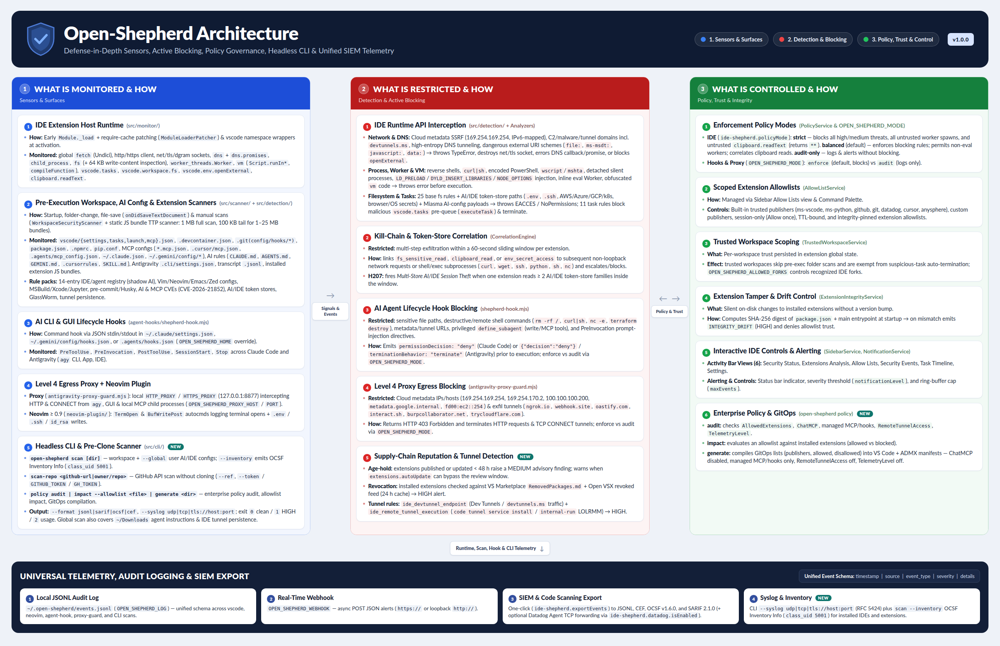

# Open-Shepherd

Universal IDE & AI-agent security monitoring, adapted from [DataDog/IDE-SHEPHERD-extension](https://github.com/DataDog/IDE-SHEPHERD-extension) with **no Datadog lock-in**.

- **VS Code family** (VS Code, Cursor, Windsurf, VSCodium, Antigravity, Trae): `src/`
- **Neovim (`>= 0.9`)**: [`neovim-plugin/lua/open_shepherd/init.lua`](neovim-plugin/lua/open_shepherd/init.lua)
- **AI CLI & GUI agents (Claude Code, Google Antigravity App / CLI / IDE)**: [`agent-hooks/shepherd-hook.mjs`](agent-hooks/shepherd-hook.mjs), [`agent-hooks/antigravity-proxy-guard.mjs`](agent-hooks/antigravity-proxy-guard.mjs)
- **Universal outputs**: Local JSONL (`~/.open-shepherd/events.jsonl`) + optional HTTP Webhook (`OPEN_SHEPHERD_WEBHOOK`)

For full setup, event schema, and configuration, see the **[Detailed Wiki](docs/WIKI.md)**.

## Project in pictures

## License & Attribution

Licensed under **Apache License 2.0** — see [LICENSE](LICENSE) and [NOTICE](NOTICE).  
This project is a fork/adaptation of `DataDog/IDE-SHEPHERD-extension` (Copyright 2025-Present Datadog, Inc.).

## Contributing

See [CONTRIBUTING.md](CONTRIBUTING.md).
